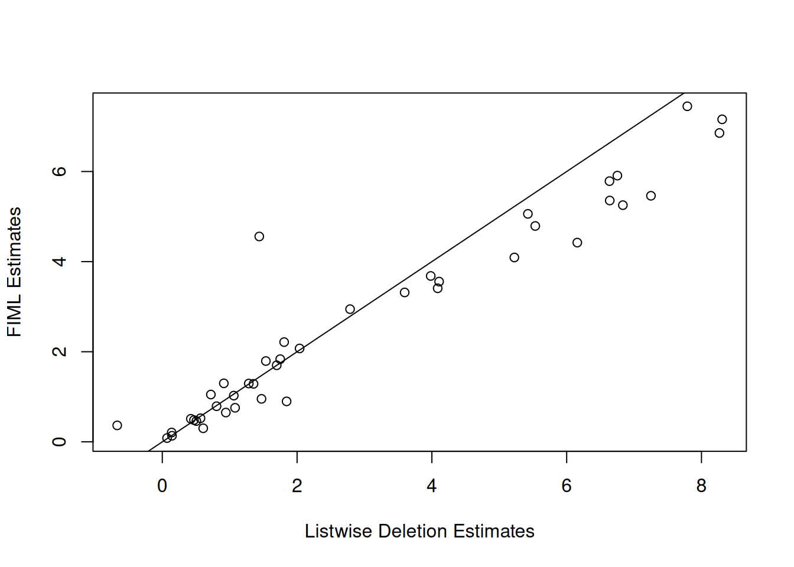

# Missing Values

[INLAvaan](https://inlavaan.haziqj.ml/) handles missing data in one of
two ways: listwise deletion (default, i.e. uses all complete cases) or
Full Information Maximum Likelihood (FIML; `missing = "ML"`).

## Simulate Data

``` r

library(INLAvaan)
mod <- "
    # Latent variable definitions
    ind60 =~ x1 + x2 + x3
    dem60 =~ y1 + y2 + y3 + y4
    dem65 =~ y5 + y6 + y7 + y8

    # Latent regressions
    dem60 ~ ind60
    dem65 ~ ind60 + dem60

    # Residual correlations
    y1 ~~ y5
    y2 ~~ y4 + y6
    y3 ~~ y7
    y4 ~~ y8
    y6 ~~ y8
  "
dat <- lavaan::PoliticalDemocracy

# Simulate missingness (MCAR)
set.seed(221)
mis <- matrix(rbinom(prod(dim(dat)), 1, 0.99), nrow(dat), ncol(dat))
datmiss <- dat * mis
datmiss[datmiss == 0] <- NA
```

## Listwise Deletion

``` r

fit1 <- asem(mod, datmiss, meanstructure = TRUE)
#> ✔ Found the posterior mode in 71 iterations [390ms]
#> ! VB mean correction, max shift 0.67σ, one-step check flagged [386ms]
#> ⠙ Fitting 18/42 skew-normal marginals
#> ⠙ Fitting 42/42 skew-normal marginals
#> ✔ Fitted 42 skew-normal marginals [638ms]
#> ⠙ Posterior sampling and summarising.
#> ✔ Summarise 1000 posterior draws. [464ms]
#> 
#> ℹ Fit measures: PPP, DIC.
#> Warning: Fit diagnostics flagged 1 potential issue:
#> ✖ The one-step VB correction failed its check: the posterior is far from
#>   Gaussian along the mean correction, most of all for `dem65~~dem65`. The solve
#>   of the VB equation that followed stopped short: one more step would move
#>   `y5~~y5` by 1.33σ.
#> ℹ Treat the marginal log-likelihood, the DIC, the LOO and the WAIC with care,
#>   and compare with MCMC, such as blavaan, if they matter. This reflects the
#>   model, the data or the priors, not a numerical failure.
#> ℹ Inspect with `diagnostics(fit)` and `diagnostics(fit, type = "param")`;
#>   `?diagnostics` explains each check.
fit1@Data@nobs[[1]] == nrow(datmiss[complete.cases(datmiss), ])
#> [1] TRUE
print(fit1)
#> INLAvaan 0.3.99.9001 ended normally after 71 iterations
#> 
#>   Estimator                                      BAYES
#>   Optimization method                           NLMINB
#>   Number of model parameters                        42
#> 
#>                                                   Used       Total
#>   Number of observations                            35          75
#> 
#> Model Test (User Model):
#> 
#>    Marginal log-likelihood                    -795.947 
#>    PPP (Chi-square)                              0.509
coef(fit1)
#>    ind60=~x2    ind60=~x3    dem60=~y2    dem60=~y3    dem60=~y4    dem65=~y6 
#>        1.808        1.750        0.944        0.806        1.473        1.062 
#>    dem65=~y7    dem65=~y8  dem60~ind60  dem65~ind60  dem65~dem60       y1~~y5 
#>        0.722        1.355        0.914        0.568        1.080        0.472 
#>       y2~~y4       y2~~y6       y3~~y7       y4~~y8       y6~~y8       x1~~x1 
#>        1.847        3.599        0.608       -0.666        1.289        0.071 
#>       x2~~x2       x3~~x3       y1~~y1       y2~~y2       y3~~y3       y4~~y4 
#>        0.144        0.424        1.700        7.792        4.087        2.788 
#>       y5~~y5       y6~~y6       y7~~y7       y8~~y8 ind60~~ind60 dem60~~dem60 
#>        1.538        6.756        2.039        3.987        0.506        1.439 
#> dem65~~dem65         x1~1         x2~1         x3~1         y1~1         y2~1 
#>        0.138        5.424        5.534        4.107        7.250        6.635 
#>         y3~1         y4~1         y5~1         y6~1         y7~1         y8~1 
#>        8.307        6.834        6.639        5.224        8.267        6.157
```

## Full Information Maximum Likelihood (FIML)

``` r

fit2 <- asem(mod, datmiss, missing = "ML", meanstructure = TRUE)
#> ⠙ Finding the posterior mode, 512 calls
#> ⠙ Finding the posterior mode, 544 calls
#> ✔ Found the posterior mode in 91 iterations [587ms]
#> ✔ VB mean correction, max shift 0.89σ [347ms]
#> ✔ Fitted 42 skew-normal marginals [1.3s]
#> ⠙ Posterior sampling and summarising.
#> ⠹ Computing fit indices (PPP/DIC).
#> ✔ Summarise 1000 posterior draws. [1s]
#> 
#> ℹ Fit measures: PPP, DIC.
print(fit2)
#> INLAvaan 0.3.99.9001 ended normally after 91 iterations
#> 
#>   Estimator                                      BAYES
#>   Optimization method                           NLMINB
#>   Number of model parameters                        42
#> 
#>   Number of observations                            75
#>   Number of missing patterns                        19
#> 
#> Model Test (User Model):
#> 
#>    Marginal log-likelihood                   -1393.023 
#>    PPP (Chi-square)                              0.047
coef(fit2)
#>    ind60=~x2    ind60=~x3    dem60=~y2    dem60=~y3    dem60=~y4    dem65=~y6 
#>        2.214        1.835        0.650        0.791        0.954        1.026 
#>    dem65=~y7    dem65=~y8  dem60~ind60  dem65~ind60  dem65~dem60       y1~~y5 
#>        1.050        1.287        1.299        0.524        0.756        0.483 
#>       y2~~y4       y2~~y6       y3~~y7       y4~~y8       y6~~y8       x1~~x1 
#>        0.899        3.317        0.302        0.366        1.295        0.084 
#>       x2~~x2       x3~~x3       y1~~y1       y2~~y2       y3~~y3       y4~~y4 
#>        0.136        0.511        1.700        7.449        3.409        2.945 
#>       y5~~y5       y6~~y6       y7~~y7       y8~~y8 ind60~~ind60 dem60~~dem60 
#>        1.794        5.910        2.073        3.682        0.462        4.558 
#> dem65~~dem65         x1~1         x2~1         x3~1         y1~1         y2~1 
#>        0.206        5.060        4.791        3.557        5.462        5.787 
#>         y3~1         y4~1         y5~1         y6~1         y7~1         y8~1 
#>        7.159        5.254        5.356        4.092        6.855        4.422
```

``` r

plot(
  coef(fit1),
  coef(fit2),
  xlab = "Listwise Deletion Estimates",
  ylab = "FIML Estimates"
)
abline(0, 1)
```



## Model criteria under FIML

[`loo()`](https://inlavaan.haziqj.ml/reference/loo.md) and
[`waic()`](https://inlavaan.haziqj.ml/reference/waic.md) work directly
on a FIML fit. Each unit is scored on the entries it actually has – the
observed-data predictive \\\log p(y\_{i,\text{obs}} \mid D\_{-i})\\,
with the full row deleted from the conditioning set – so a case with
more missing entries contributes a smaller log-likelihood term *and* a
smaller score, self-weighting in the expected log predictive density.
The missing-at-random assumption that justifies FIML estimation also
justifies this predictive score.

``` r

loo(fit2)
#> ── Leave-one-subject-out ────────────────────────── 75 subjects, second-order ──
#> 
#>          Estimate   SE
#> elpd_loo  -1286.9 36.6
#> p_loo        38.3  3.1
#> looic      2573.8 73.2
#> 
#> ── Curvature check ─────────────────────────────────────────────────────────────
#> 
#>   first-to-second-order gap        23.3
#>   pD/2 (trace)                     19.1
#>   excess over pD/2 (trace)       +21.9%
#> 
#> ℹ The gap approaches pD/2 (trace) from above. A large excess says the
#>   second-order expansion has not settled over the sample.
```

Comparing two FIML fits with `compare(..., loo = TRUE)` is valid only
when they share the same observed entries – the same data *and* the same
missingness pattern – since each unit is scored on the entries it has.
See the [cross-validation
article](https://inlavaan.haziqj.ml/articles/loo.md) for the Taylor
case-deletion method itself.

Two-level FIML fits are also supported: they are scored per cluster
(leave-one-cluster-out), each cluster contributing its observed-data
marginal likelihood. The per-row deletion diagnostic (`type = "loso"`)
is not available under missing data.
