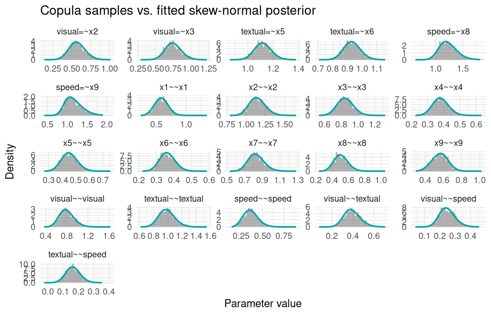

# Sampling from the Generative Model

## Purpose

After fitting a Bayesian SEM with INLAvaan, we often want to **draw
samples from the model** itself—either using posterior or prior
parameter values. The
[`sampling()`](https://inlavaan.haziqj.ml/reference/sampling.md)
function does exactly this: it propagates parameter draws through the
full generative chain

\\ \underbrace{\boldsymbol\theta}\_{\text{parameters}}
\\\longrightarrow\\ \underbrace{\boldsymbol\eta}\_{\text{latent
variables}} \\\longrightarrow\\
\underbrace{\mathbf{y}^\*}\_{\text{observed variables}} \\

producing samples that are **not tied to any individual observation**.
This is distinct from
[`predict()`](https://inlavaan.haziqj.ml/reference/predict.md), which
returns individual-specific factor scores \\\boldsymbol\eta \mid
\mathbf{y}, \boldsymbol\theta\\.

Typical use cases include **posterior predictive checks** (PPCs) and
**prior predictive checks**; the [predictive checks
article](https://inlavaan.haziqj.ml/articles/predictive-checks.md) walks
through that workflow.

## `sampling()` versus `simulate()`

INLAvaan offers two ways to draw data from the generative model, and the
difference is *what varies between draws*:

|  | One draw is | Returns | Use for |
|----|----|----|----|
| [`sampling()`](https://inlavaan.haziqj.ml/reference/sampling.md) | one \\\boldsymbol\theta^{(s)}\\ → **one observation** \\\mathbf{y}^{\*(s)}\\ | a matrix (or list) | distributions of *quantities*: parameters, implied moments |
| [`simulate()`](https://inlavaan.haziqj.ml/reference/simulate.md) | one \\\boldsymbol\theta^{(s)}\\ → a **whole dataset** of \\n\\ rows | a list of data frames | *replicate datasets*: PPC overlays, test statistics, SBC |

[`sampling()`](https://inlavaan.haziqj.ml/reference/sampling.md)
refreshes \\\boldsymbol\theta\\ at every draw, pooling parameter
uncertainty and sampling variability into a single marginal predictive
distribution.
[`simulate()`](https://inlavaan.haziqj.ml/reference/simulate.md) holds
each \\\boldsymbol\theta^{(s)}\\ fixed for a whole dataset, so variation
*across* replicates reflects parameter uncertainty while variation
*within* a replicate reflects sampling variability—which is what makes
replicates exchangeable with the observed data, and hence the right tool
for predictive checks and simulation-based calibration. Both functions
accept `prior = TRUE`. The rest of this article covers
[`sampling()`](https://inlavaan.haziqj.ml/reference/sampling.md).

## The generative model

Let \\\boldsymbol\theta^{(s)}\\ (\\s = 1, \dots, S\\) denote one
parameter draw. From this draw the SEM matrices \\\boldsymbol\Lambda\\,
\\\boldsymbol\Psi\\, \\\mathbf{B}\\, \\\boldsymbol\alpha\\,
\\\boldsymbol\nu\\, and \\\boldsymbol\Theta\\ are constructed. The
generative chain is:

**1. Latent variables.** \\ \boldsymbol\eta^{(s)} \sim
\mathcal{N}\\\bigl( (\mathbf{I} - \mathbf{B})^{-1}\boldsymbol\alpha,\\
\boldsymbol\Phi \bigr), \qquad \boldsymbol\Phi = (\mathbf{I} -
\mathbf{B})^{-1}\boldsymbol\Psi\\ \[(\mathbf{I} - \mathbf{B})^{-1}\]'.
\\

**2. Observed variables.** \\ \mathbf{y}^{\*(s)} \sim
\mathcal{N}\\\bigl( \boldsymbol\Lambda\\\boldsymbol\eta^{(s)} +
\boldsymbol\nu,\\ \boldsymbol\Theta \bigr). \\

When `prior = FALSE` (default), \\\boldsymbol\theta^{(s)}\\ comes from
the posterior; when `prior = TRUE`, each parameter is drawn
independently from its prior.

## Quick start

``` r

dat <- lavaan::HolzingerSwineford1939
mod <- "
  visual  =~ x1 + x2 + x3
  textual =~ x4 + x5 + x6
  speed   =~ x7 + x8 + x9
"
fit <- acfa(mod, dat, silent = TRUE)
```

### Parameter samples

The default type `"lavaan"` returns an \\S \times p\\ matrix of
lavaan-side (constrained) parameter draws:

``` r

theta_post <- sampling(fit, type = "lavaan", nsamp = 2000)
dim(theta_post)
#> [1] 2000   21
head(theta_post[, 1:4])
#>      visual=~x2 visual=~x3 textual=~x5 textual=~x6
#> [1,]  0.6218149  0.9054224   1.1243687   0.9962427
#> [2,]  0.5512860  0.8047698   1.2134491   0.9165999
#> [3,]  0.5590414  0.7006104   0.9801455   0.9244519
#> [4,]  0.5567977  0.7638096   1.1415673   1.0356761
#> [5,]  0.5949406  1.0227456   1.0731359   0.8664578
#> [6,]  0.3631219  0.7057723   1.0889885   0.8696295
```

### Latent and observed samples

``` r

eta  <- sampling(fit, type = "latent",   nsamp = 1000)
ystar <- sampling(fit, type = "observed", nsamp = 1000)
dim(eta)    # 1000 x 3 (one per latent factor)
#> [1] 1000    3
dim(ystar)  # 1000 x 9 (one per observed indicator)
#> [1] 1000    9
```

### Everything at once

``` r

all_samps <- sampling(fit, type = "all", nsamp = 1000)
names(all_samps)
#> [1] "lavaan"   "theta"    "latent"   "observed" "implied"
```

## Comparing samples to the fitted marginals

INLAvaan approximates each marginal posterior with a skew-normal
density. We can overlay the
[`sampling()`](https://inlavaan.haziqj.ml/reference/sampling.md)
histogram (drawn via the copula method, which couples the fitted
marginals by a Gaussian copula) on top of the fitted density curve
stored in `pdf_data` to verify that they agree.

``` r

# 1. Draw copula samples
samp_cop <- sampling(fit, type = "lavaan", nsamp = 1000)

# 2. Retrieve the fitted skew-normal densities
int <- fit@external$inlavaan_internal
pdf_data <- int$pdf_data

# 3. Build a long data frame for ggplot
par_names <- colnames(samp_cop)
hist_df <- data.frame(
  param = rep(par_names, each = nrow(samp_cop)),
  value = as.vector(samp_cop)
)
hist_df$param <- factor(hist_df$param, levels = par_names)

curve_df <- do.call(rbind, Map(function(nm, df) {
  data.frame(param = nm, x = df$x, y = df$y)
}, par_names, pdf_data[par_names]))
curve_df$param <- factor(curve_df$param, levels = par_names)

# 4. Plot
ggplot(hist_df, aes(x = value)) +
  geom_histogram(aes(y = after_stat(density)), bins = 50,
                 fill = "grey40", alpha = 0.5) +
  geom_line(data = curve_df, aes(x = x, y = y),
            colour = "#00A6AA", linewidth = 0.8) +
  facet_wrap(~param, scales = "free") +
  labs(x = "Parameter value", y = "Density",
       title = "Copula samples vs. fitted skew-normal posterior") +
  theme_minimal(base_size = 11)
```



Figure 1: Copula samples (histogram) versus the fitted skew-normal
marginal (red curve) for all free parameters.

## Prior sampling

Both [`sampling()`](https://inlavaan.haziqj.ml/reference/sampling.md)
and [`simulate()`](https://inlavaan.haziqj.ml/reference/simulate.md)
accept `prior = TRUE`: each free parameter is drawn independently from
its prior (the data play no role) and propagated through the generative
chain. Draws that imply a non-positive-definite covariance matrix are
rejected and redrawn, so the exact prior is preserved. What these draws
are useful for—and how to read them when the model has no mean
structure—is the subject of the [predictive checks
article](https://inlavaan.haziqj.ml/articles/predictive-checks.md).
